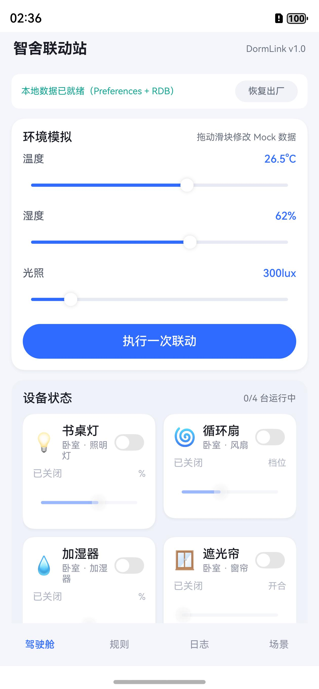
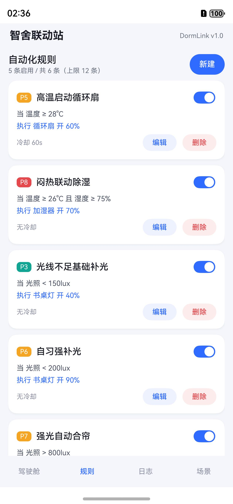
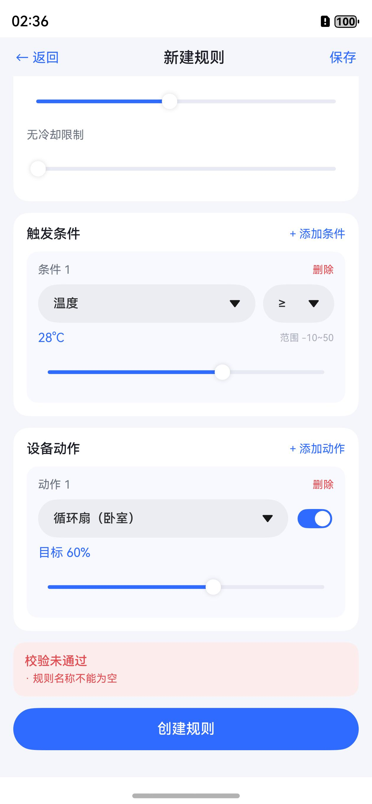
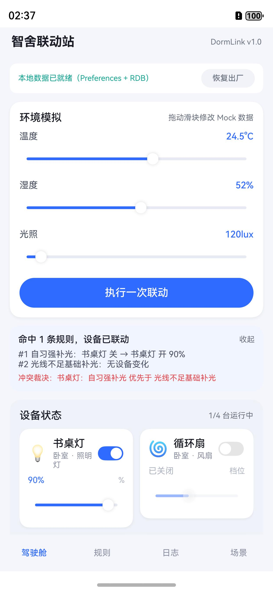
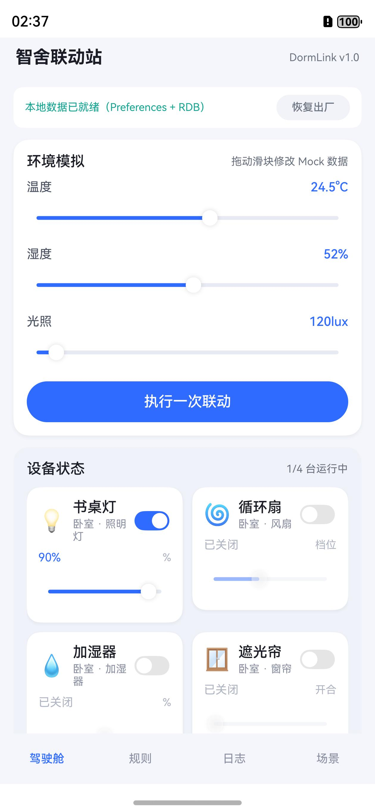
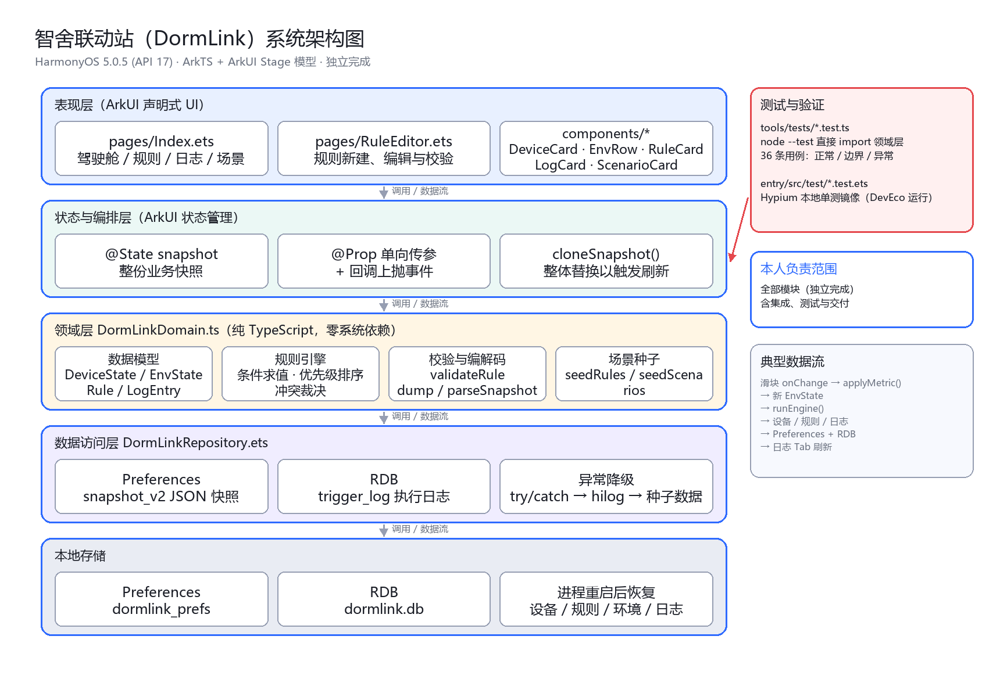
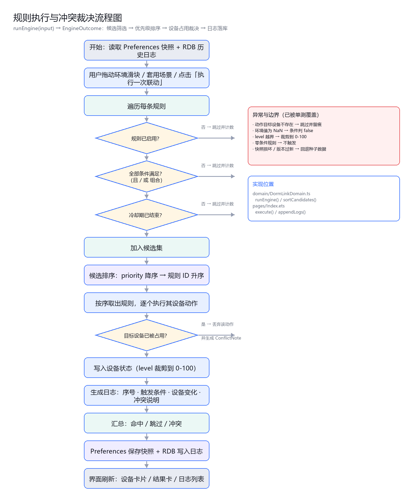

# 智舍联动站 DormLink · 智能宿舍自动化规则编排

> 《鸿蒙高级应用开发工程师认证》期末大作业 · 选题三「联动实验室」
> 独立完成 · 23 物联 2 班
> GitHub 账号：**eekl123** · 仓库地址：**https://github.com/eekl123/SmartDormLink**

DormLink 是一个跑在 HarmonyOS 手机/平板上的**智能宿舍联动规则编排 + 模拟演练**应用。
用户自己定义「满足什么条件 → 执行哪些设备动作」的自动化规则，拖动模拟环境滑块或用预设场景一键演练，
立刻能看到哪些规则命中、设备怎么变化、执行顺序如何、冲突被谁裁决，并且可以退到后台杀掉进程后重新打开继续使用。

不需要真实硬件，也不需要服务器：环境数据是 Mock 的，设备是软件模拟的，一切都在本机完成。

---

## 一、功能一览

| 选题要求 | 本项目实现 |
| --- | --- |
| ≥4 类可控制设备 | 4 类：照明灯、风扇、加湿器、窗帘（`DEVICE_META`，均在驾驶舱可手动开关与调档） |
| ≥3 项可调整模拟环境数据 | 3 项：温度 -10~50°C、湿度 0~100%、光照 0~2000lux（驾驶舱滑块实时可调） |
| ≥4 条规则，含 1 条双条件规则 | 内置 6 条种子规则，其中「闷热联动除湿」为温度 + 湿度双条件；规则可增删改、可启停 |
| 规则引擎按实际输入计算触发结果 | `runEngine()` 真实求值：启用判断 → 且/或条件组合 → 冷却判断 → 优先级排序 → 设备写入 |
| 记录触发条件、设备变化和执行顺序 | 每条命中规则写一条日志：执行序号 `order`、触发条件文案、设备变化前后、冲突说明 |
| 冲突需明确执行顺序或优先级 | 优先级降序 + 规则 ID 升序；同设备仅接受第一条写入，后续丢弃并生成 `ConflictNote` |
| ≥2 组环境场景演练 | 「深夜自习」24.5°C/52%/120lux、「梅雨午后」31.5°C/88%/900lux，一键套用并演练 |
| 保存设备设置、规则和执行记录 | Preferences 存整份业务快照；RDB 存执行日志；进程重启后全部恢复 |
| Mock 数据 + ArkTS 条件判断 + 状态管理 + 事件通信 + Preferences/RDB + 单元测试 | 全部具备，详见下文 |

补充能力：规则表单校验（空名、重名、阈值越界、设备不存在、冷却越界、规则数量上限）、
恢复出厂设置、清空日志、执行结果浮层动画、日志倒序查询。

## 二、开发环境

| 项 | 版本 |
| --- | --- |
| 操作系统 | Windows 11 |
| DevEco Studio | 5.0.13.230（`DS-233.14475.28.36.5013230`） |
| HarmonyOS SDK | 5.0.5 (API 17)，`sdk-pkg.json` 记录 `apiVersion: 17` |
| 兼容版本 | `compatibleSdkVersion: "5.0.5(17)"`，`runtimeOS: HarmonyOS`，Stage 模型 |
| 构建工具 | hvigor 5.17.5（DevEco 自带） |
| 测试运行环境 | Node.js ≥ 22.6（本项目实测 v24.11.1，利用原生 TS 类型擦除直接跑 `.ts`） |
| 单元测试框架 | Node 内置 `node:test` + Hypium 1.0.13（DevEco 本地单测） |

## 三、目录结构

```
SmartDormLink/
├── AppScope/                            应用级配置（bundleName、图标、应用名）
├── entry/
│   ├── build-profile.json5
│   ├── oh-package.json5                 依赖：@ohos/hypium（本地单测用）
│   └── src/
│       ├── main/
│       │   ├── module.json5             模块与 EntryAbility 配置
│       │   ├── ets/
│       │   │   ├── entryability/EntryAbility.ets
│       │   │   ├── pages/Index.ets      四 Tab 主页面：驾驶舱/规则/日志/场景
│       │   │   ├── pages/RuleEditor.ets 规则新建与编辑页
│       │   │   ├── components/          DeviceCard · EnvRow · RuleCard · LogCard · ScenarioCard
│       │   │   ├── domain/
│       │   │   │   └── DormLinkDomain.ts  领域层（模型/引擎/校验/编解码/场景），零系统依赖
│       │   │   └── service/
│       │   │       └── DormLinkRepository.ets  Preferences + RDB 数据访问层
│       │   └── resources/               字符串、颜色、图标、页面清单
│       └── test/                        Hypium 本地单元测试（DevEco 内运行）
│           ├── List.test.ets            测试入口聚合
│           ├── Engine.test.ets          引擎与冲突裁决
│           ├── Validator.test.ets       规则校验
│           └── Codec.test.ets           持久化编解码
├── tools/
│   ├── tests/                           可直接用 node --test 运行的自动化测试
│   │   ├── engine.test.ts
│   │   ├── validator.test.ts
│   │   └── codec.test.ts
│   └── report/                          图表与报告生成脚本
├── docs/
│   ├── 软件需求说明书.md
│   ├── 截图与录屏清单.md
│   ├── 资料核查与新技术笔记.md
│   └── images/                          架构图、流程图
├── scripts/build.ps1                    命令行构建脚本（含中文路径规避）
├── build-profile.json5
├── hvigorfile.ts
└── oh-package.json5
```

## 四、运行方法

### 4.1 用 DevEco Studio 运行（推荐）

1. **把工程放到纯英文路径**（例如 `D:\HarmonyProjects\SmartDormLink`）。
   hvigor 不支持含中文的工程路径，直接放在中文目录会报 `Invalid project path`。
2. DevEco Studio → `File → Open` 选择该目录，等待 Sync 完成。
   Sync 会自动执行 ohpm 安装依赖（需要能访问 `https://repo.harmonyos.com/ohpm/`）。
3. `File → Project Structure → Signing Configs` 勾选 **Automatically generate signature**（需登录华为账号）。
4. 选择模拟器（Device Manager 中创建，需已开启 Hyper-V/WHPX）或真机，点击 **Run ▶**。

### 4.2 命令行构建 HAP

```powershell
# 工程在英文路径下
powershell -ExecutionPolicy Bypass -File scripts\build.ps1

# 工程在中文路径下：脚本会自动复制到 ASCII 工作目录 C:\dsh_build\SmartDormLink 再构建
powershell -ExecutionPolicy Bypass -File scripts\build.ps1
```

脚本会依次设置 `DEVECO_SDK_HOME`、`JAVA_HOME`（DevEco 自带 JBR）、`HVIGOR_USER_HOME`，
并把 DevEco 自带的 hvigor 以 junction 方式链入工程，**无需联网**。
产物：`entry/build/default/outputs/default/entry-default-unsigned.hap`。

> 未配置签名时产物是 unsigned HAP，仅用于验证编译；安装到设备请用 DevEco 的自动签名。

### 4.3 运行自动化测试

```powershell
# 36 条领域层测试，直接跑源码（无需编译）
node --test tools/tests/engine.test.ts tools/tests/validator.test.ts tools/tests/codec.test.ts
```

在 DevEco 中也可以运行 Hypium 本地单测：打开 `entry/src/test/List.test.ets`，
右键 → `Run 'List.test.ets'`（需已完成 ohpm 依赖安装）。

## 五、核心设计

### 5.1 分层

```
ArkUI 页面/组件  →  @State 快照 + cloneSnapshot 整体替换  →  领域层纯函数  →  数据访问层  →  Preferences / RDB
```

- **领域层 `DormLinkDomain.ts`**：不 import 任何 `@ohos.*`，是纯 TypeScript。
  好处是同一份源码既能被 ArkTS 编译进 App，也能被 `node --test` 直接执行，
  测试跑的就是 App 里跑的那份逻辑。
- **数据访问层 `DormLinkRepository.ets`**：Preferences 存乐观快照，RDB 存日志；
  所有读写都有 try/catch，读失败回退种子数据，写失败降级为内存态并通过 Toast 提示。

### 5.2 冲突裁决规则

1. 命中规则按 `priority` 降序排列；优先级相同则按规则 ID 升序（保证结果可复现）。
2. 同一台设备只接受**第一次**写入（即最高优先级那一次），后续写入被丢弃。
3. 被丢弃的写入生成 `ConflictNote`（谁胜出、谁被丢弃、原因），写入日志并在界面提示。
4. 每条命中规则无论是否有设备变化都会留日志，便于复盘。

### 5.3 数据模型

| 对象 | 关键字段 | 存储 |
| --- | --- | --- |
| `DeviceState` | `id / kind / name / room / power / level(0-100)` | Preferences 快照 |
| `EnvState` | `temperature / humidity / illuminance` | Preferences 快照 |
| `Rule` | `id / name / enabled / logic / conditions[] / actions[] / priority(1-10) / cooldownSec / lastFiredAt` | Preferences 快照 |
| `LogEntry` | `id / at / order / ruleId / conditionsText / changesText / conflictText / fired` | RDB 表 `trigger_log` |
| `Snapshot` | `version / savedAt / env / devices / rules / activeScenarioId` | Preferences key `snapshot_v2` |

### 5.4 RDB 表结构

```sql
CREATE TABLE IF NOT EXISTS trigger_log (
  id TEXT PRIMARY KEY NOT NULL,   fired_at INTEGER NOT NULL,  source TEXT NOT NULL,
  ord INTEGER NOT NULL,           rule_id TEXT NOT NULL,      rule_name TEXT NOT NULL,
  priority INTEGER NOT NULL,      conditions_text TEXT NOT NULL,
  changes_text TEXT NOT NULL,     conflict_text TEXT NOT NULL, fired INTEGER NOT NULL
);
```

## 六、测试与证据

| 测试文件 | 用例数 | 覆盖 |
| --- | --- | --- |
| `tools/tests/engine.test.ts` | 16 | 单条件/双条件/或逻辑命中、优先级冲突、同优先级稳定性、冷却窗口、level 裁剪、空条件、NaN 环境、目标设备不存在、纯函数语义 |
| `tools/tests/validator.test.ts` | 11 | 合法规则、编辑自身不误报重名、空名/重名/超长、空条件/空动作、条件数 3 与 4 的边界、阈值端点与越界、优先级 1/10/0/11/小数、动作 level 0/100/101、设备不存在、冷却 3600/3601、规则数上限 12 |
| `tools/tests/codec.test.ts` | 9 | 快照往返、改环境→触发→保存→重启恢复全链路、空/坏 JSON、版本过新、v1 迁移、脏字段清洗、空规则列表、200 次往返性能 |

### 6.1 Node 直跑（`node --test`）

实测：`tests 36 / pass 36 / fail 0`，耗时约 0.2s。输出见 `docs/evidence/test-output.txt`。

### 6.2 DevEco 本地单测（Hypium 1.0.13，真机同款运行时）

`entry/src/test` 下 20 条 Hypium 用例经 `hvigor test` 实际执行：

```
Tests run: 20, Failure: 0, Error: 0, Pass: 20, Ignore: 0
覆盖率：行 73.7%（417/566） / 函数 75.0%（33/44） / 分支 60.1%（113/188）
```

| 套件 | 用例 |
| --- | --- |
| `DormLinkRuleEngine` | 8 条：命中、双条件、gte 边界、裁剪、冷却、缺失设备、优先级冲突、种子数据 |
| `DormLinkRuleValidator` | 6 条：合法、空名、未知设备、阈值越界、优先级越界、数量上限 |
| `DormLinkPersistenceCodec` | 6 条：往返、重启恢复、坏 JSON、版本过新、v1 迁移、脏字段 |

证据：`docs/evidence/hypium-test-result.txt`（逐条 Success）、`hypium-coverage-summary.json`、
`hypium-run-log.txt`（Hypium 运行日志）。复现：`hvigor ... test` 或 DevEco 中运行 `entry/src/test/List.test.ets`。

## 七、截图与录屏

以下均为在 HarmonyOS 5.0.5 模拟器（1260×2720）上**实际运行**截取，截图旁附有当时的 UI 文本快照
（`*.layout.txt`），可核对画面内容。

### 驾驶舱（默认状态）



### 规则列表



### 规则编辑与校验拦截



### 场景演练后的联动结果


### 执行日志（执行顺序与冲突裁决）


### 进程重启前后的持久化对比

| 重启前 | 重启后 |
| --- | --- |
|  |  |

### 演示录屏

[`docs/demo.mp4`](docs/demo.mp4)（24 秒，630×1360，H.264；由模拟器真实画面帧序列合成——
该模拟器镜像未内置 `screenrecord`，故用 `snapshot_display` 连续取帧后编码）

### 架构图与流程图





拍摄与复现方式见 [`docs/截图与录屏清单.md`](docs/截图与录屏清单.md)。

## 八、已知限制

- 设备与环境均为软件模拟，不接入真实硬件或云平台（选题本身不要求）。
- 规则最多 12 条、每条最多 3 个条件 / 4 个动作，属于产品设计上的有意约束。
- 规则条件只支持单指标阈值比较（含 `=`），暂不支持跨指标运算或时间条件。
- UI 采用原生组件与固定配色，未做深色模式与横屏适配。
- 动画使用全局 `animateTo`；多窗口/多实例场景下更稳妥的写法是 `UIContext.animateTo`（见 `docs/资料核查与新技术笔记.md`）。
- **截图来源说明**：截图与录屏取自 DevEco 自带 HarmonyOS 5.0.5 模拟器（开发版镜像，允许安装未签名 HAP），
  真机上的界面完全一致；录屏因镜像未内置 `screenrecord`，改用连续帧合成。

## 九、证据文件

| 文件 | 内容 |
| --- | --- |
| `docs/evidence/test-output.txt` | Node 侧 36 条用例的完整运行输出（可复现） |
| `docs/evidence/hypium-test-result.txt` | Hypium 20 条用例逐条 Success 的原始结果 |
| `docs/evidence/hypium-coverage-summary.json` | Hypium 覆盖率汇总（行 73.7% / 函数 75% / 分支 60.1%） |
| `docs/evidence/hypium-run-log.txt` | Hypium 运行时日志（含每条用例的 pass 记录） |
| `docs/evidence/build-output.txt` | hvigor 完整构建日志（BUILD SUCCESSFUL） |
| `docs/images/architecture.png` | 系统架构图（`tools/report/make_diagrams.py` 生成） |
| `docs/images/rule_flow.png` | 规则执行与冲突裁决流程图 |

报告生成：`python tools/report/make_report.py`（从 `git log` 取提交记录、从源码抽取代码片段、从证据文件取测试结果）。

## 十、提交说明

- 本仓库为个人独立完成，全部代码由本人提交。
- 报告：按学校命名规范生成（`鸿蒙高级应用开发工程师认证-学号-姓名-期末大作业报告.docx`），作为附件单独提交。
- 学习通答案处需同时填写：GitHub 仓库链接 + 本人 GitHub 账号。
